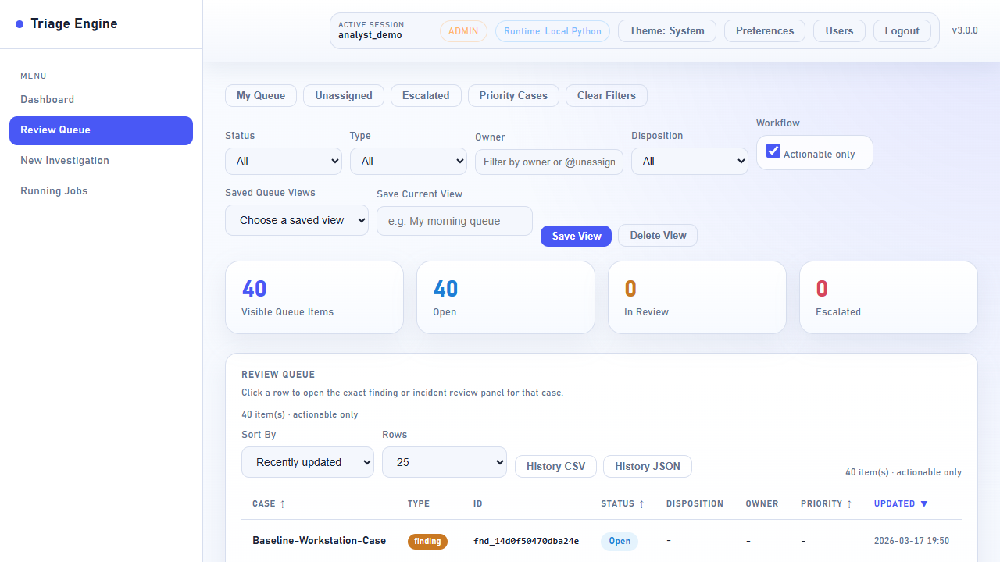
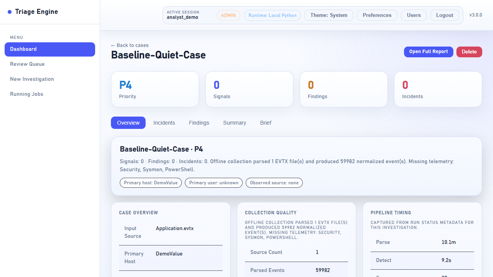
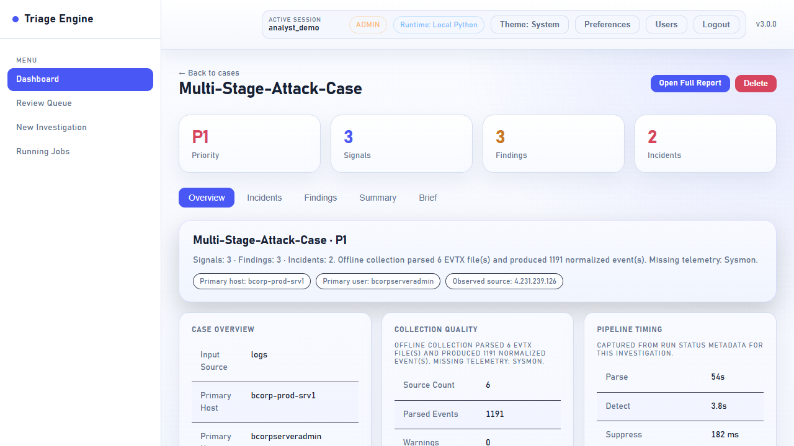
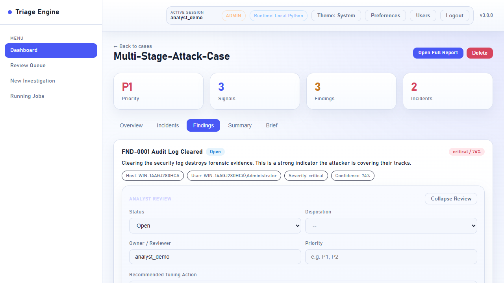
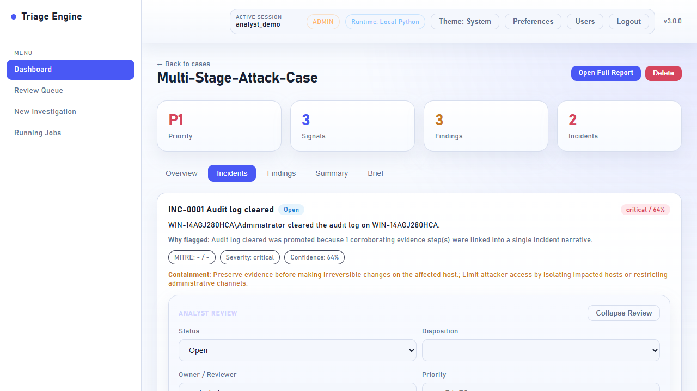
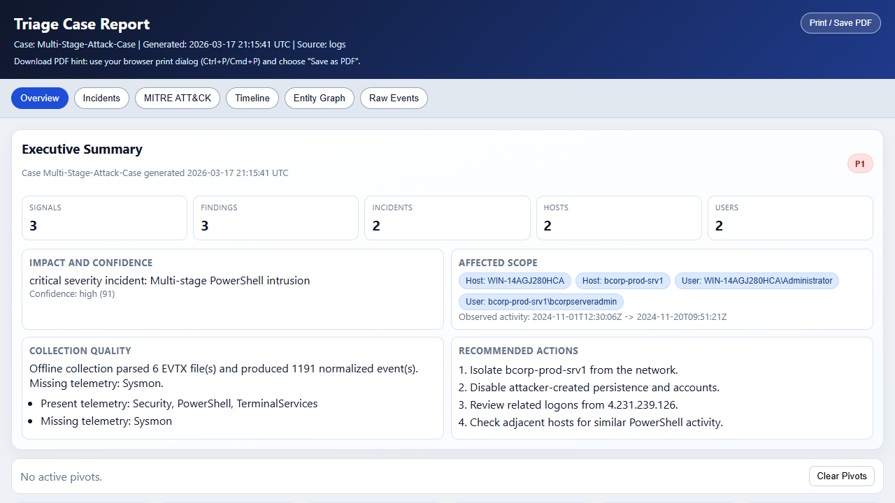

# Triage Engine

Windows endpoint investigation tool for EVTX files and local Windows collection. It creates findings, incidents, timelines, and HTML case reports.

## What it does

- Reads EVTX files offline
- Collects local Windows telemetry
- Runs built-in detections and optional Sigma rules
- Groups alerts into findings and incidents
- Tracks review status, owners, notes, and dispositions
- Writes HTML, Markdown, and JSON case outputs
- Runs with Python or Docker

## Screenshots

### Review Queue

Review status, ownership, and assignment.



### Baseline Case

A quieter case used as a comparison point.



### Attack Case

A case with findings, incidents, and analyst notes.



### Finding Detail

Finding status, disposition, owner, notes, and evidence.



### Incident Detail

Incident severity, confidence, containment guidance, and escalation.



### HTML Report

Case summary and investigation output.



## Demo

The public walkthrough uses two cases:

- `Baseline-Quiet-Case`
- `Multi-Stage-Attack-Case`

Run the baseline first, then the attack case. Compare the Review Queue, case details, findings, and HTML report.

## Quick start

Offline investigations and the dashboard run on Windows, Linux, and macOS. Live collection is Windows-only.

### Python on Windows

```powershell
cd C:\path\to\triage-engine
powershell -ExecutionPolicy Bypass -File .\start-triage.ps1 -BootstrapDeps
```

### Python on Linux or macOS

```bash
cd ~/triage-engine
python3 -m venv .venv
source .venv/bin/activate
python -m pip install --upgrade pip
python -m pip install -e ".[server,sigma]"
python server.py
```

### Docker

```bash
docker compose up --build
```

Open `http://127.0.0.1:8000`.

On first run, create the first admin account, run a baseline case, and run an attack case.

## Command line

```bash
triage investigate --evtx /path/to/logs --case Baseline-Workstation-Case
```

On Windows, use a Windows path such as `C:\path\to\logs`.

## Case outputs

- `report.html`
- `summary.txt`
- `incident_brief.md`
- `findings.json`
- `timeline.json`
- `graph.json`
- `run_status.json`

## Configuration

See the [configuration reference](./docs/configuration.md) for environment variables.

For public screenshots and demos, set `TRIAGE_DEMO_REDACTION=1`. Keep local tuning in `config/tuning/local.json`; that file should stay out of source control.

## Checks

```powershell
python .\scripts\production_readiness.py
python .\scripts\competitive_eval.py --manifest .\config\benchmark\corpus.json --report .\competitive_eval.json --skip-hayabusa --fail-on-expectation
python .\scripts\release_gate.py --config .\config\release_gate.json --strict --report .\release_gate.json
```

See [Production Readiness](./docs/production-readiness.md) and [Quality Gates](./docs/quality-gates.md) for details.

## Limits

- Live collection is Windows-only
- EVTX demo data is not included
- Sigma support needs the optional extras
- Large EVTX collections take longer than the small demo cases

## License

[MIT](./LICENSE)
