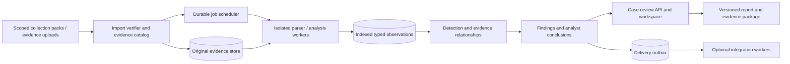

# Corrobora: repository audit and forensic expansion direction

Date: 2026-10-02. Baseline: `6a790a6` (clean tracked working tree at audit start).

Audience confirmed by the owner: incident-response teams and consultants. Scope includes the requested expansion beyond EVTX into forensic triage. This document records the baseline audit and proposed design before the subsequently authorized implementation. Source references and defect reproductions below describe that baseline. The first implemented phase and its current verification are recorded in [forensic foundation](../forensic-foundation.md), with usage and limits in [artifact intake](../forensic-artifacts.md). Persistent user case data was not changed.

## Recommendation

Build an **offline-first Windows forensic triage and investigation workbench**. Its promise should be: **collect selected evidence, reconstruct activity, review the conclusions, and deliver a verifiable case package**.

The existing product already supplies useful detection, correlation, analyst review, and reporting. The next advantage should be the quality of the investigation and its evidence trail. Broader artifact support makes that advantage stronger when multiple independent sources corroborate or contradict a finding. Customer demand and willingness to pay still need pilot evidence.

Make the analyst case the main product. Keep Quick Check as a collection/intake option. Treat EVTX as the first supported source behind an extensible acquisition and parsing boundary. Preserve local operation and the existing CLI/API contracts throughout migration.

“Premium” should mean reproducible conclusions, reliable recovery, responsive evidence exploration, clear uncertainty, controlled case access, and excellent deliverables. Those qualities should drive architecture and acceptance checks.

## What the repository actually supports

The current supported deployment is one application process, local SQLite state, and case directories. The documentation explicitly prohibits multiple Uvicorn workers because job admission, scheduling, and Quick Check capabilities use process-local state (`docs/deployment.md:3–5,64–66`). This is a reasonable portable/pilot foundation.

Preserve these strengths:

- A shared investigation service used by the CLI and server, normalized event models, native behavioral detections, and additive Sigma evaluation.
- Process isolation and timeouts for importable native detectors; explicit partial-failure and parser diagnostics (`corrobora/service.py:675–800,1790–1848`).
- Separate signals, findings, incidents, attributable review notes/history, queues, timeline, graph, and HTML/JSON deliverables.
- Per-host verdicts and mixed-host/long-window warnings already exist (`corrobora/evidence_scope.py:82–206`). The remaining need is explicit investigation scope and stronger correlation boundaries.
- Guided Quick Check, UAC handling, CSRF-aware bundle download, local frontend assets, and Windows packaging already exist. Several “open” items in the older product audit contradict its implementation update; do not rebuild completed features from that list.
- A substantial automated test suite and benchmark tooling. Passing tests establish the behaviors covered by those checks; they do not establish real-world detection accuracy or forensic completeness.

The current intake contract is still `evtx_path` or `live` Windows event channels (`corrobora/service.py:105–136`). Forensic expansion requires a broader evidence model, rather than putting registry or filesystem artifacts into invented Windows Event IDs.

## Material findings

Priority P1 means address before relying on the affected behavior in paid operational use. P2 means a foundation needed for the proposed expansion. Static architectural risks are distinguished from defects reproduced during this audit.

| Priority | Finding and evidence | Consequence | Recommended action |
|---|---|---|---|
| P1, reproduced | Backup enumerates only `auth.db`, `reviews.db`, and `jobs.db` and uses `shutil.copy2` (`scripts/backup_restore.py:19,80–88`). Profiles/metadata use `product.db` in WAL mode (`corrobora/product.py:159–172`). | Product state is excluded. Copying only a live database's main file can also omit committed WAL transactions. An isolated reproduction copied a database with one committed row; querying the copy returned `no such table: audit_probe`. | Include all state stores. Use SQLite's backup API or a verified quiesced snapshot; coordinate case artifacts with state. Test restoration with active WAL, client profiles, reviews, jobs, and a complete case. |
| P1, reproduced | Sigma's Boolean parser short-circuits the parsing calls (`corrobora/sigma_runner.py:65–103`). Unsupported modifiers fall through to equality (`:32–57`; loader `corrobora/sigma_loader.py:45–63`). | Supported parenthesized conditions can produce false matches or miss matches. `(a or b) and c` returned true for `a=true,b=false,c=false`; `(a and b) or c` returned false for `a=false,b=true,c=true`. A `contains\|all` rule loaded and ran with no rejection diagnostic despite unsupported semantics. | Parse the entire expression independently of evaluation short-circuiting; require complete token consumption. Explicitly reject unsupported modifiers/conditions. Add truth-table and end-to-end rule fixtures before importing larger packs. |
| P1 for forensic claims, reproduced | `NormalizedEvent` lacks source-file identity and EventRecordID (`models/event_model.py:43–68`). Raw export omits `raw_xml` and shares the display-collapse iterator (`reporting/json_export.py:26–70,181–218,243–255`). Default bundles contain derived artifacts, with hashes of included members (`corrobora/product.py:312–365`). | The exported “raw” stream is a normalized presentation artifact, not a lossless source archive. Two benign PowerShell events with distinct ScriptBlockIds exported as one collapsed row; their XML and one ID were absent. Original EVTX is not inherently included. Member hashes protect exported bytes but do not bind conclusions to original evidence or analysis configuration. | Preserve original acquired bytes when authorized, stable record locators, acquisition manifests, and analysis manifests. Separate lossless observations from display summaries. Clearly label export classes and allow source inclusion policies. |
| P2, static risk | Job rows are durable, but execution/admission are an in-memory executor/semaphore (`server.py:312–325,858–881`). Startup cleans uploads for completed/failed jobs but has no queued/running reconciliation (`:1139–1143`; `corrobora/job_store.py:168–174`). | A crash can strand active job records and work. Adding API workers does not make scheduling safe. | First define interrupted/retry behavior. Then persist the request, attempts, leases, heartbeat, cancellation, and artifact publication state; execute jobs in supervised worker processes. |
| P2, verified contract limit | Users have installation-wide roles; case/review guards do not check engagement membership (`server.py:1334–1340,3401–3407,4402–4419`). Client metadata is keyed by case name (`corrobora/product.py:186–189`). | Client labels organize a trusted team's work; they are not client isolation. A shared consultancy deployment needs controlled engagement access. | Add stable engagement/case IDs and membership. Apply authorization consistently to evidence, jobs, reviews, exports, and audit views. Keep single-team deployments simple. |
| P2, static risk | Attack chains join consecutive alerts on the same host when adjacent gaps are within 60 minutes; risk increases with alert/tactic counts (`correlation/attack_chain.py:56–99`). Confidence scores use fixed additive points (`corrobora/confidence.py:140–164`). | A chain can span much longer than one hour through successive adjacent alerts. Shared host/time proximity does not establish causal relationships. Scores are prioritization heuristics; there is no calibration evidence establishing probabilities. | Correlate through typed entity/session/process/file relations, bounded scope, and explicit relationship reasons. Distinguish observations, inferred links, analyst-confirmed links, severity, and evidence strength. Retain explainable factors. |
| P2, static scalability limit | Both EVTX paths accumulate lists, then directory parsing retains/aggregates per-file lists (`parser/evtx_reader.py:272–423,514–535,671–782`). The service passes the event collection through detection and reporting (`corrobora/service.py:1844,1930–2050,2193–2244`). | XML streaming and JSONL output do not make end-to-end memory bounded. More forensic sources and parallel workers can increase peak memory substantially. No large-workload memory profile was run in this audit. | Parse bounded batches into an indexed observation store; give detectors/query tools bounded views. Benchmark peak RSS and worker concurrency before selecting a faster parser or analytics engine. |
| P2, validation gap | Competitive expectations check finding/incident counts, not expected technique correctness (`scripts/competitive_eval.py:204–253`). Dataset preparation clones an unpinned shallow checkout (`scripts/prepare_benchmark_inputs.py:67–92`). Readiness treats nonempty tuning as configured (`scripts/production_readiness.py:62–103`). | A wrong detection can satisfy a malicious sample's count threshold. Changing upstream data and skipped corpus tests weaken reproducibility. Nonempty tuning is not evidence of effective tuning. | Pin and hash corpora/rules; assert expected source-linked behaviors per sample; require the mandatory corpus to execute in release gates. Measure clean-environment false promotions and blind holdout performance. |
| P2, maintainability limit | At this baseline, `server.py` has 4,876 lines, `service.py` 2,295, and `static/dashboard.js` 2,634. HTTP, authorization, persistence, orchestration, and exports are concentrated. Some async routes perform synchronous file/ZIP work (`server.py:3248–3276,3401–3417`). | Expansion crosses large shared change boundaries. Large exports/slow disk may block requests; latency impact is not measured here. | Extract cohesive routers/use cases/repositories incrementally. Offload bounded blocking operations. Preserve the offline frontend while separating API, state, timeline, and review modules. |

There is also a release-environment inconsistency: the readiness CI job installs `.[server,sigma]`, while the readiness script invokes pytest and imports HTTP API tests requiring test dependencies (`.github/workflows/quality-gates.yml:109–118`; `pyproject.toml:19`; `scripts/production_readiness.py:40–50`). Install the explicit test extra in that job and verify in a clean runner; this audit did not execute hosted CI.

## Forensic expansion: answer questions across sources

Start with a small number of collection packs that answer common IR questions. Each pack declares supported OS/artifact versions, permission needs, byte/time limits, collection effects, data sensitivity, parser dependencies, and completeness status. Analysts select packs for the engagement; bulk collection should not be the default.

| Expansion order | Evidence sources | Investigation value | Required interpretation boundary |
|---|---|---|---|
| First: persistence | Selected registry autoruns, scheduled task definitions, service configuration, startup folders, selected WMI persistence objects, file hashes/signatures; combine with existing EVTX | Find what is configured to start and connect it to suspicious process/file evidence | Current configuration establishes observed persistence state; it does not establish installation time or maliciousness by itself. Autoruns is a possible adapter; redistribution and tool-version decisions need evaluation. |
| First: execution history | Prefetch, Amcache, AppCompatCache/Shimcache; later BAM/DAM and selected user execution artifacts | Corroborate program presence and execution when process logs are absent | Preserve artifact-specific meanings and timestamp types. Amcache/AppCompatCache entries alone must not be upgraded into proof of execution. Missing artifacts can reflect OS/configuration/retention differences. |
| Next: filesystem chronology | Acquired `$MFT`, `$UsnJrnl`, relevant file metadata; selected LNK/Jump Lists | Correlate file creation, movement, deletion, and user interaction with processes and persistence | Preserve record/sequence identifiers and timestamp semantics. Journal history can be incomplete; path/name reuse must not merge unrelated files. |
| Next: delivery and user activity | Selected browser download/history databases, Zone.Identifier, PowerShell history, selected remote-access application logs | Connect delivery, user activity, execution, and persistence | Collect only agreed profiles/sources. Downloads/history are context, not proof of execution or user intent. Record locked-file and acquisition limitations. |
| Later: volatile state and memory | Time-stamped process/network snapshots, imported memory images and selected Volatility results | Inspect activity absent from durable logs and investigate suspicious processes | A live snapshot is current state. Memory acquisition is a separate privileged operation; images, symbols, parser/tool versions, failures, and resource costs belong in provenance. |
| Later: other evidence ecosystems | Velociraptor collection imports; reviewed Hayabusa/Chainsaw output imports; selected identity/cloud audit exports; mounted/read-only disk-image artifact imports | Reuse collection/parsing ecosystems and extend investigations across endpoint/account evidence | Preserve external findings as externally derived observations with source references and tool versions; do not treat two engines interpreting the same record as independent corroboration. |

This progression is technically grounded: [Microsoft Autoruns](https://learn.microsoft.com/en-us/sysinternals/downloads/autoruns) enumerates numerous autostart locations; [Velociraptor's execution-evidence documentation](https://docs.velociraptor.app/docs/forensic/evidence_of_execution/) explains Prefetch and registry execution artifacts and their interpretation limits. [Chainsaw](https://github.com/WithSecureOpenSource/chainsaw) already supports broader Windows forensic artifacts. These sources support feasibility, not a claim that this repository implements those features.

For collection, consider a versioned import adapter for [Velociraptor offline collection containers](https://docs.velociraptor.app/docs/deployment/offline_collections/) before building a general remote agent. Its collector model already separates predefined collection from subsequent import. [Volatility's Windows tutorial](https://volatility3.readthedocs.io/en/latest/getting-started-windows-tutorial.html) supports a later memory-analysis adapter; symbol availability means offline preparation is part of that feature. Do not implement a memory driver or every binary artifact parser in this product.

An example of the intended experience: a responder selects a suspicious endpoint and time window; the workbench links a browser download, a process-log record, Prefetch evidence, and a scheduled task pointing to the same file. Every link shows the source record and reason. If only an inventory entry exists, the interface says “file observed; execution unconfirmed.” The analyst records a conclusion, alternatives, missing evidence, and requested follow-up collection. The report includes that reviewed reasoning and its references. This scenario is proposed behavior, not a demonstrated capability today.

## Target architecture

Use a modular Python application with separate collector and supervised worker processes. FastAPI and the existing detection engine remain useful. Introduce boundaries before distributed infrastructure.



The diagram is the proposed design. Original evidence, observations, analysis runs, and analyst review must remain distinguishable.

### Domain and data contracts

| Object | Minimum contract |
|---|---|
| Engagement / case | Stable UUID, human label, client attribution, explicit membership, investigation scope, retention policy and exceptions |
| Evidence object | Source identity, original bytes or explicit external reference, SHA-256, length, media/artifact type, host identity, acquisition tool/version, collector identity, collection time, completeness/errors |
| Observation | Stable ID, evidence-object ID, record locator, discriminated kind/payload, original timestamp + interpretation/timezone/precision, normalized time where valid, entity references, parser/schema version |
| Analysis run | Immutable input manifest, engine/parser/rule/tuning digests, configuration, job/attempt, resource/completeness diagnostics, output manifest |
| Relationship / finding | Supporting and contradicting observation IDs, relationship type/reason, rule identity/version, severity, evidence factors, limitations, policy version |
| Analyst conclusion | Attributed decision, rationale, supporting/contradicting references, review history, version; kept separately from generated findings |
| Export snapshot | Frozen source/run/review references, included/omitted source policy, artifact hashes, redaction policy, export time/actor; optional signature and verifiable signer identity |

Do not hash only display strings for identity. Evidence content hashes identify bytes; observation IDs also need the evidence object, stable locator, and parser/schema identity. Preserve original host names and normalization decisions to avoid collapsing distinct systems sharing a short hostname.

A hash verifies byte consistency. A signature can establish a trusted signer. Neither establishes that a compromised endpoint supplied truthful or complete evidence. Keep those distinctions visible in the acquisition record.

### Storage and execution

For the portable edition, use local immutable evidence files plus SQLite metadata and indexed observations. Keep writes transactionally coherent where possible. Consolidate closely related case/run/job/review publication metadata behind repositories; identity can remain a separate store with a complete coordinated backup. A temporary file followed by atomic publication makes derived artifacts visible only after successful generation.

Start with a persisted local job state machine and one supervised worker: queued, leased/running, completed, failed, interrupted, cancelled. Store the complete request, attempt number, heartbeat, lease expiry, and output-manifest state. Crash recovery must decide whether a stage can restart safely; do not assume every task is idempotent. Use immutable per-run output and transactional publication of the current successful run. An outbox decouples webhook delivery from investigation completion and records delivery retries.

Keep original evidence outside disposable runtime directories. Example intentional layout:

```text
data/state/                 metadata databases
data/evidence/<object-id>/   original evidence and acquisition records
cases/<case-id>/runs/        versioned derived results and manifests
cases/<case-id>/exports/     published snapshots
runtime/temp/<job-id>/       disposable worker scratch
runtime/logs/                operational diagnostics
artifacts/test-output/      controlled CI artifacts, if adopted consistently
```

Retain existing data/case locations during migration; the layout is a target, not a request to move or delete current evidence. Existing test/runtime conventions can remain until an intentional migration is made.

SQLite WAL supports concurrent readers but one writer and same-host coordination; keep it for local operation rather than placing it on a shared network filesystem. [SQLite WAL documentation](https://www.sqlite.org/wal.html) supports those constraints. Use PostgreSQL metadata and shared evidence storage when actual requirements include multiple service hosts or sustained concurrent writes. API worker processes do not share Python state; [FastAPI deployment guidance](https://fastapi.tiangolo.com/deployment/concepts/) explains this boundary. A queue broker, Kubernetes, Neo4j, or a full event-sourcing system is not required for the first professional edition.

Parser adapters should declare inputs, outputs, schemas, supported versions, and resource budgets. Run reviewed parsers/tools in worker subprocesses with bounded CPU/memory/time/output and restricted network access; an ordinary subprocess is not a complete security sandbox. Reject unsafe archives and unauthorized source types; isolate unsupported schemas. Preserve recoverable partial evidence with explicit truncation/errors and source-level completeness. Incomplete or ambiguous results cannot be published as a complete analysis. Preserve native detector isolation already present.

Do not force all forensic observations through Sigma. Keep the supported EVTX Sigma path and add source-specific artifact analysis plus cross-source relationships. The [official Sigma specification](https://sigmahq.io/sigma-specification/) separately defines rule, correlation, filter, and modifier semantics; advertise a validated compatibility subset until broader support is proven.

### Code boundaries and migration

Proposed modules under the existing `corrobora/` package:

```text
domain/        evidence, observations, scopes, runs, findings, conclusions
application/   import, investigate, review, export, recover, retain
adapters/      evtx, live collector, artifact parsers, external tool imports
storage/       evidence files, repositories, schema migrations, snapshots
jobs/          scheduler, worker protocol, cancellation, recovery, outbox
api/           routers, typed contracts, authentication/membership dependencies
```

Keep existing detectors/correlation/reporting usable through compatibility adapters first. Extract HTTP routers without changing responses. Add provenance fields additively and version the contracts. Imported legacy cases must be marked `legacy_provenance_incomplete`; never synthesize nonexistent source hashes or record identities. Run the old and new pipelines over frozen fixtures, compare source-linked outputs, then switch defaults. Do not undertake a simultaneous frontend rewrite, storage migration, and detector rewrite.

For collection elevation, prefer a narrowly scoped collector/helper with fixed capabilities, explicit collection plans, expiry, and an authenticated local handoff. The current elevation path launches a server (`server.py:2197–2231`). A future richer collector should not require elevating the complete analyst application. Signed Windows releases and clean-machine acceptance remain release work; [Microsoft SignTool](https://learn.microsoft.com/en-us/windows/win32/seccrypto/signtool) documents signing, timestamping, and verification mechanisms.

## Professional analyst experience and commercial boundary

Design the main flow as **Engagement → Scope → Collect/import → Investigate → Review → Deliver**. Put the available evidence and gaps beside the conclusions.

Prioritize source-record drill-down, timeline pivots across artifact types, evidence search with saved views, explicit uncertain/inferred relationships, hypotheses and alternatives, lead/peer review, and a frozen client report. A client-facing report should explain scope, acquisition, methods, key observations, reviewed conclusions, limitations, and next actions; include an evidence appendix and reproducibility manifest.

A plausible paid offering is consultant productivity: multiple engagements, controlled team review, reliable collection packs, reproducible reruns/diffs, and polished client deliverables. Keep essential evidence verification and honest uncertainty available in every edition. Do not use raw rule count or an uncalibrated score as the premium value proposition. Pricing and packaging should follow observed pilot value.

AI can later help search or draft text with cited observation IDs and recorded model/prompt versions. Generated content stays advisory until reviewed, and deterministic evidence findings remain separate. Existing optional AI/Jev connectors are not a reason to make external inference part of the required workflow.

## Delivery sequence and acceptance gates

| Stage | Concrete deliverable | Exit evidence |
|---|---|---|
| 0: establish trustworthy baseline | Fix backup/WAL coverage, Sigma Boolean semantics and rejection behavior, raw/export labeling, explicit interrupted-job behavior, clean CI dependencies | Reproductions now pass meaningful regression checks; a complete case restores with active WAL; supported Sigma truth tables agree; interrupted work cannot masquerade as completed |
| 1: evidence and run foundation | Evidence catalog, stable case/source/observation IDs, lossless source retention policy, immutable run manifests, staged publication, bounded ingest/query abstraction | Tampering rejected; every new finding resolves to its source; reruns disclose rule/tuning changes; missing/partial inputs cannot yield a complete-evidence claim; legacy cases remain readable |
| 2: first forensic pack | Persistence + execution artifacts alongside EVTX; offline pack import; evidence-type timeline/search; source-specific interpretation labels | Windows-version fixtures; malformed/locked/missing artifacts handled explicitly; no Amcache/Shimcache-only execution claims; cross-source pivots resolve to original evidence; install works without network |
| 3: consultant workflow | Engagement membership, peer review, hypotheses, frozen report/export, restore/upgrade acceptance | Access matrix covers every evidence/job/export route; concurrent review changes handled; exported snapshot verifies offline; upgrade preserves cases and review history |
| 4: deepen reconstruction | Filesystem and selected delivery/user-activity artifacts, cross-source relationship explanations, comparison of collection/run versions | Known scenarios and benign holdouts reviewed blind; repeated same-source evidence is not counted as independent support; peak memory and timeline query latency measured on an agreed large corpus |
| 5: demand-led expansion | Memory-results import, selected live-memory acquisition integration, external collector/disk/cloud imports, optional team-server storage | Demonstrated pilot blocker/value; supported versions/tool provenance documented; symbols/tools available for offline use; acquisition/resource limits validated on clean supported hosts |

No calendar estimate is defensible before the first forensic adapter and provenance migration are scoped. These stages describe dependencies and acceptance criteria, not a guaranteed schedule.

Pilot with 3–5 IR teams/consultants using sanitized historical incidents and representative clean administrative activity. Measure time to a **reviewed, evidence-supported conclusion**, unsupported-claim rate, false promotions per case/host, collection completeness, reproduction/restore success, report usefulness, and technician intervention. Define agreed workload budgets and target improvements before evaluation; current evidence does not justify a real-world accuracy or speed percentage.

Defer continuous EDR behavior, arbitrary remote command execution, a general fleet agent, automated containment, broad OS coverage, a full disk-imaging suite, large unvalidated Sigma imports, and distributed infrastructure until these gates and customer demand justify them. Selected forensic evidence and interoperable imports can take the product much further while keeping its scope supportable.

## Verification and limits

Fresh verification: `python -m pytest tests -q -p no:cacheprovider` completed with exit code 0: **619 passed, 188 skipped, 78 subtests passed**, and one expected duplicate-ZIP warning from tamper-verification coverage, in 836.69 seconds. The run used isolated project-owned data/case/temp directories, explicit `--basetemp`, and `--junitxml`. Structured results report zero failures and zero errors. Skips predominantly cite unavailable EVTX samples; they do not count as verified detection coverage.

Three focused reproductions completed successfully as audit experiments and demonstrated the defects/limits described above. They did not repair the application during the audit; repairs followed in the separately recorded implementation phase.

Raw evidence is separate from this report under `runtime/test-output/architecture-audit-2026-10-02/`:

- `pytest.log`, `pytest.xml`, and `pytest-summary.json`: fresh suite output, structured result, and skip reasons.
- `backup-reproduction.json`: missing product database and missing committed WAL-backed schema in the copied backup.
- `sigma-reproduction.json`: two incorrect supported Boolean evaluations and silent unsupported modifier acceptance.
- `raw-export-reproduction.json`: two source events collapse to one exported row with original XML and one ScriptBlockId absent.

Independent read-only passes covered runtime/storage, detection/correlation/Sigma, and product workflows. A fresh architecture review checked the material source claims, reproduction artifacts, expansion references, and sequencing. Its corrections to verification status and handling of partial forensic inputs were incorporated. The parent verified the material source findings and ran the focused reproductions. No persistent user database or environment-secret contents were inspected; supplied application state was not altered.

Organization check: the only new untracked documentation is this file in `docs/audits/`. Raw audit evidence and isolated test data are inside the ignored project `runtime/` tree; no task output was found in the workspace parent or project root. Automatic approval review rejected removal of disposable test directories with the reason “blocked by policy.” Consequently, `runtime/temp/architecture-audit-2026-10-02/` and the `data/` and `cases/` children of the audit test-output directory remain contained. Existing unrelated runtime data and artifacts were preserved.

This baseline audit did not run a new public-corpus benchmark, a live/UAC acquisition, a clean-host installer/signing test, Docker acceptance, a real browser acceptance run, or large-input memory profiling. The subsequent first phase adds persistence snapshot intake and a collector script; its synthetic CLI/browser checks are documented separately. Engagement membership and the broader architecture remain proposals. Existing heuristic confidence and public fixture coverage do not establish calibrated real-world detection performance.
